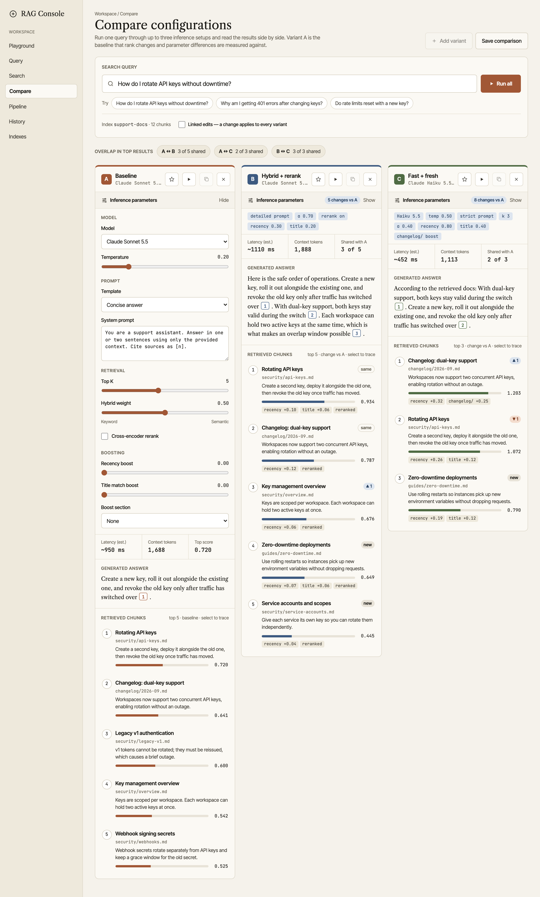
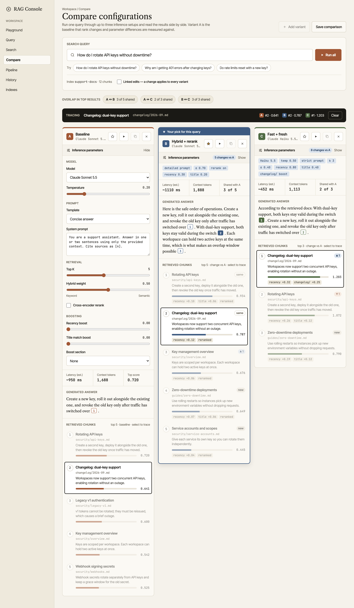

# Compare — inference params (design)

Design source for the Compare screen: run one search query through up to three
inference configurations and read the results side by side.

Live canvas: https://claude.ai/artifact/VZqAHyiJK9PXRpqSWBibmM (private until shared)

Tracing a document across variants, with B marked as the pick:

## Files

| File | What it is |
| --- | --- |
| `Main.dc.html` | **Chosen direction.** Variant columns with editable model, temperature, prompt template / system prompt, top K, hybrid weight, rerank, recency / title / section boosts. Results show rank change vs A, score breakdown, document tracing across columns, "≠ A" param markers, linked edits and a best-pick marker. |
| `Console.dc.html` | Exploration 1 — Signal Desk: mixing-console channel strips with faders and solo. |
| `River.dc.html` | Exploration 2 — Rank River: slopegraph of rank movement between configs. |
| `Matrix.dc.html` | Exploration 3 — Heat Matrix: params and per-doc ranks in one aligned grid. |
| `Diff.dc.html` | Exploration 4 — Config Diff: base/head config diff with results and answer diffs. |
| `Arena.dc.html` | Exploration 5 — Blind Arena: anonymised side-by-side answers with voting. |
| `canvas.json` | Canvas layout index. |

## Notes

- Retrieval, scores, latency and token counts are **simulated** in-page over a
  12-document sample corpus; nothing calls `/api/search` yet.
- Files are Design Component pages (`.dc.html`) and render inside the Claude
  Design canvas runtime, not as standalone HTML. Implementation target is
  `static/views/Compare.jsx`.
